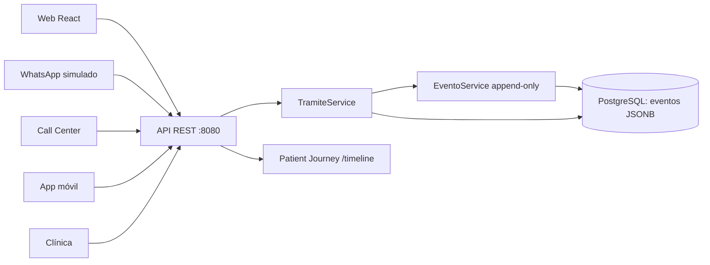
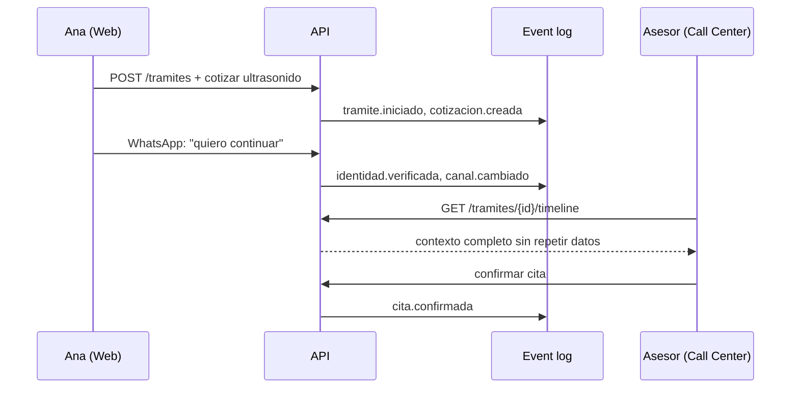

# Arquitectura — Salud Digna Omnicanal

Modular monolith Spring Boot 3.3 + React + PostgreSQL. Un solo deploy, módulos
por contexto acotado (Identidad, Trámite, Eventos, Catálogo, Canales) con
límites hexagonales para poder partirlo en microservicios después.

## Flujo de datos



## Modelo de datos

```mermaid
erDiagram
  PACIENTE ||--o{ TRAMITE : tiene
  TRAMITE ||--o{ EVENTO : genera
  TRAMITE ||--o| CITA : agenda
  TRAMITE }o--|| ESTUDIO : cotiza
  TRAMITE }o--|| CLINICA : elige
  PACIENTE { uuid id PK, string telefono UK, string email, date fechaNacimiento }
  TRAMITE { uuid id PK, string folio UK, string estado, uuid pacienteId FK }
  EVENTO { uuid id PK, uuid tramiteId FK, string tipo, string canal, string actor, jsonb payload, timestamp ts }
```

## Secuencia del demo de Ana



## Decisiones

1. Event log append-only: el estado se reconstruye desde eventos; nada escribe estado directo.
2. Teléfono como llave de identidad principal (WhatsApp = teléfono); folio como llave de continuidad.
3. Canales simulados sobre la misma API; si Salud Digna da sandbox real, se conecta el mismo endpoint.
4. Seguridad demo: JWT + fallback header `X-Rol` documentado como simplificación de hackatón, no producción.
5. Datos 100% sintéticos (Ana ficticia). Nada de datos reales de pacientes.
